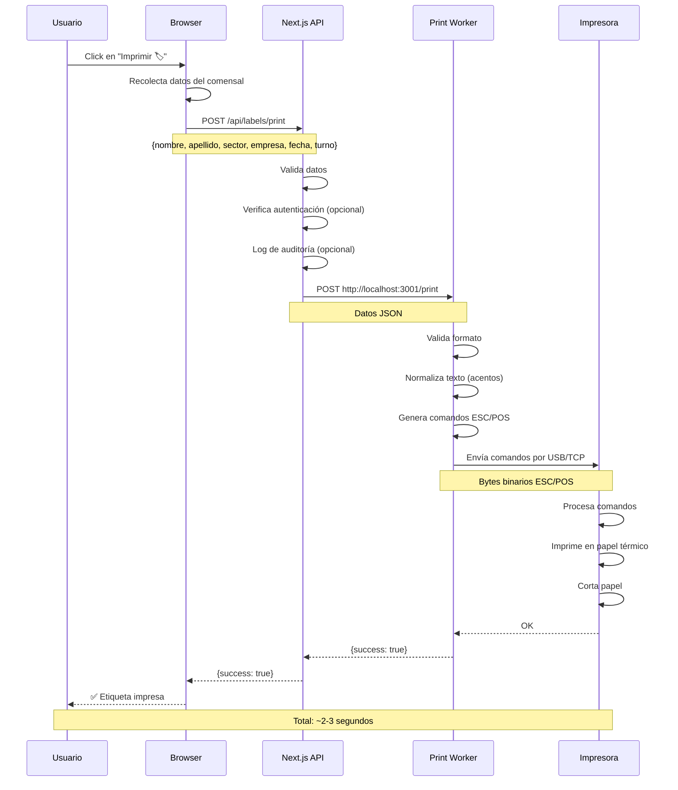

# Diagramas de Arquitectura - Sistema de Impresión Térmica

## Arquitectura General del Sistema

```
┌──────────────────────────────────────────────────────────────────────┐
│                         MORA GASTRONOMÍA                              │
│                      Sistema de Gestión Web                           │
│                      (Next.js + Supabase)                             │
└───────────────────────────────┬──────────────────────────────────────┘
                                │
                                │ Datos de comensales
                                │
                ┌───────────────┴───────────────┐
                │                               │
                v                               v
    ┌──────────────────────┐       ┌──────────────────────┐
    │  Informe de Viandas  │       │  Informe Comensales  │
    │   /viandas           │       │  /comensales         │
    └──────────────────────┘       └──────────┬───────────┘
                                               │
                                               v
                                   ┌──────────────────────┐
                                   │ Vista de Impresión   │
                                   │ /comensales/imprimir │
                                   └──────────┬───────────┘
                                               │
                                               │ Click "Imprimir"
                                               │
                                               v
                                   ┌──────────────────────┐
                                   │  API Route           │
                                   │  /api/labels/print   │
                                   └──────────┬───────────┘
                                               │
                                               │ HTTP POST
                                               │
                                               v
                                   ┌──────────────────────┐
                                   │  Print Worker        │
                                   │  (Node.js + Express) │
                                   │  Puerto 3001         │
                                   └──────────┬───────────┘
                                               │
                                               │ Comandos ZPL/ESC-POS
                                               │
                                               v
                                   ┌──────────────────────┐
                                   │  Impresora Térmica   │
                                   │  (USB/Red)           │
                                   └──────────────────────┘
                                               │
                                               v
                                        🏷️ Etiqueta impresa
```

## Flujo de Datos Detallado

### 1. Preparación de Datos

```
┌─────────────────┐
│   Supabase DB   │
└────────┬────────┘
         │
         │ Query: Datos del día
         │ - Empleados activos
         │ - Sectores
         │ - Empresa
         │ - Elecciones de menú
         │ - Turnos
         │
         v
┌─────────────────┐
│  loadDiners()   │  (lib/diners.ts)
└────────┬────────┘
         │
         │ Procesa y estructura:
         │ {
         │   id: string
         │   apellido: string
         │   nombre: string
         │   sectorId: string
         │   choices: {...}
         │   mealShift: 'MORNING' | 'AFTERNOON'
         │ }
         │
         v
┌─────────────────┐
│  Página React   │
│  Renderiza      │
│  tabla con      │
│  botón 🏷️      │
└─────────────────┘
```

### 2. Proceso de Impresión

```
Usuario click en 🏷️
         │
         v
┌─────────────────────────────────────┐
│  PrintLabelButton Component         │
│  (Componente React)                 │
└───────────────┬─────────────────────┘
                │
                │ fetch('/api/labels/print', {
                │   method: 'POST',
                │   body: JSON.stringify({
                │     nombre: 'María',
                │     apellido: 'García',
                │     sector: 'Administración',
                │     empresa: 'Zuliani Hnos.',
                │     fecha: '27/11/2026',
                │     turno: 'MORNING'
                │   })
                │ })
                │
                v
┌─────────────────────────────────────┐
│  Next.js API Route                  │
│  /app/api/labels/print/route.ts     │
│                                     │
│  - Valida datos                     │
│  - Autentica usuario (opcional)     │
│  - Log de auditoría (opcional)      │
└───────────────┬─────────────────────┘
                │
                │ fetch('http://localhost:3001/print', {
                │   method: 'POST',
                │   body: JSON.stringify(datos)
                │ })
                │
                v
┌─────────────────────────────────────┐
│  Print Worker                       │
│  Node.js + Express                  │
│                                     │
│  POST /print                        │
│    1. Recibe datos JSON             │
│    2. Valida datos                  │
│    3. Normaliza texto (acentos)     │
│    4. Genera comandos impresora     │
│    5. Envía a impresora             │
└───────────────┬─────────────────────┘
                │
                │ Comandos ESC/POS:
                │ - 0x1B 0x61 0x01 (centrar)
                │ - 0x1B 0x45 0x01 (negrita)
                │ - "MORA GASTRONOMIA\n"
                │ - ...
                │
                v
┌─────────────────────────────────────┐
│  Driver de Impresora                │
│  (USB/Red)                          │
└───────────────┬─────────────────────┘
                │
                v
        ┌──────────────┐
        │  Impresora   │
        │   Térmica    │
        └──────┬───────┘
               │
               v
        🏷️ Etiqueta física
```

## Componentes Principales

### 1. Base de Datos (Supabase)

```
┌─────────────────────────────────────────────────────────┐
│  profiles                                                │
│  ├─ id (UUID)                                           │
│  ├─ nombre (string)                                     │
│  ├─ apellido (string)                                   │
│  └─ dni (string)                                        │
└──────────┬──────────────────────────────────────────────┘
           │
           │ 1:N
           │
┌──────────┴──────────────────────────────────────────────┐
│  memberships                                             │
│  ├─ user_id (FK → profiles.id)                          │
│  ├─ company_id (FK → companies.id)                      │
│  ├─ sector_id (FK → company_sectors.id)                 │
│  ├─ role (EMPLOYEE | COMPANY_ADMIN)                     │
│  └─ status (ACTIVE | INACTIVE)                          │
└──────────┬──────────────────────────────────────────────┘
           │
           │ N:1
           │
┌──────────┴──────────────────────────────────────────────┐
│  companies                                               │
│  ├─ id (UUID)                                           │
│  ├─ nombre_comercial (string)                           │
│  └─ meal_shifts_enabled (boolean)                       │
└──────────┬──────────────────────────────────────────────┘
           │
           │ 1:N
           │
┌──────────┴──────────────────────────────────────────────┐
│  company_sectors                                         │
│  ├─ id (UUID)                                           │
│  ├─ company_id (FK → companies.id)                      │
│  ├─ name (string)                                       │
│  └─ sort_order (int)                                    │
└──────────┬──────────────────────────────────────────────┘
           │
           │ 1:N
           │
┌──────────┴──────────────────────────────────────────────┐
│  v_selection_details (vista)                             │
│  ├─ employee_id (FK → profiles.id)                      │
│  ├─ service_date (date)                                 │
│  ├─ company_id (FK → companies.id)                      │
│  ├─ meal_shift (MORNING | AFTERNOON)                    │
│  └─ category_id, option_name, ...                       │
└─────────────────────────────────────────────────────────┘
```

### 2. Frontend (Next.js App Router)

```
app/
├── (app)/
│   └── comensales/
│       ├── page.tsx
│       │   │
│       │   └── Muestra filtros y link a imprimir
│       │
│       └── imprimir/
│           └── page.tsx  ⭐
│               │
│               ├── Server Component
│               │   ├── loadDiners() ← Fetch de Supabase
│               │   └── Renderiza DinerTable
│               │
│               └── DinerTable
│                   └── Para cada diner:
│                       └── PrintLabelButton (Client Component)
│
├── api/
│   └── labels/
│       └── print/
│           └── route.ts  ⭐
│               │
│               ├── POST: Imprime etiqueta
│               └── GET: Health check
│
└── components/
    ├── diner-table.tsx
    └── print-label-button.tsx  ⭐ (nuevo)
        │
        └── 'use client'
            ├── Estado: printing, error
            ├── onClick: fetch('/api/labels/print')
            └── Muestra: 🏷️ / ⏳ / ❌
```

### 3. Print Worker (Node.js)

```
print-worker/
├── package.json
│   └── dependencies:
│       ├── express
│       ├── node-thermal-printer
│       └── cors
│
├── server.js  ⭐
│   │
│   ├── Configuración
│   │   ├── PRINTER_CONFIG
│   │   │   ├── type: EPSON/STAR/etc
│   │   │   ├── interface: USB/TCP
│   │   │   └── characterSet
│   │   │
│   │   └── PORT: 3001
│   │
│   ├── Endpoints
│   │   ├── GET  /health
│   │   │   └── { status: 'ok' }
│   │   │
│   │   ├── POST /print
│   │   │   ├── Valida datos
│   │   │   ├── Normaliza texto
│   │   │   ├── Genera etiqueta
│   │   │   └── printer.execute()
│   │   │
│   │   └── POST /test
│   │       └── Imprime etiqueta de prueba
│   │
│   └── Funciones
│       └── normalizeText()
│           └── Quita acentos y caracteres especiales
│
└── README.md
    └── Instrucciones de instalación
```

### 4. Impresora Térmica

```
┌─────────────────────────────────────────────────────────┐
│                   IMPRESORA TÉRMICA                      │
│                                                          │
│  Conexión:                                              │
│  ├─ USB (04b8:0e15)                                     │
│  └─ Red (192.168.1.100:9100)                            │
│                                                          │
│  Protocolos:                                            │
│  ├─ ESC/POS (Epson, Star, etc)                          │
│  └─ ZPL (Zebra)                                         │
│                                                          │
│  Configuración:                                         │
│  ├─ Ancho papel: 80mm                                   │
│  ├─ Velocidad: 150-200 mm/s                             │
│  ├─ Densidad: 203 DPI                                   │
│  └─ Corte: Automático                                   │
│                                                          │
│  Consumibles:                                           │
│  └─ Rollo térmico 80mm × 50mm (1000 etiquetas)         │
└─────────────────────────────────────────────────────────┘
```

## Secuencia de Eventos Completa



## Diagrama de Despliegue

```
┌─────────────────────────────────────────────────────────────────┐
│                         INTERNET                                 │
└────────────────────────────┬────────────────────────────────────┘
                             │
                             │ HTTPS
                             │
┌────────────────────────────┴────────────────────────────────────┐
│                       VERCEL                                     │
│  ┌────────────────────────────────────────────────────────┐    │
│  │  Next.js App                                           │    │
│  │  - Pages (SSR/SSG)                                     │    │
│  │  - API Routes (/api/labels/print)                      │    │
│  │  - Static assets                                       │    │
│  └────────────────────────────────────────────────────────┘    │
└────────────────────────────┬────────────────────────────────────┘
                             │
                             │ PostgreSQL Protocol
                             │
┌────────────────────────────┴────────────────────────────────────┐
│                      SUPABASE                                    │
│  ┌────────────────────────────────────────────────────────┐    │
│  │  PostgreSQL Database                                   │    │
│  │  - profiles, memberships, companies, etc               │    │
│  └────────────────────────────────────────────────────────┘    │
└──────────────────────────────────────────────────────────────────┘

┌──────────────────────────────────────────────────────────────────┐
│                   RED LOCAL (Cocina/Despacho)                    │
│                                                                  │
│  ┌───────────────────────────────────────────────────────┐     │
│  │  Computadora/Servidor Local                           │     │
│  │  (Raspberry Pi / Mini PC / Servidor)                  │     │
│  │                                                        │     │
│  │  ┌──────────────────────────────────────────────┐    │     │
│  │  │  Print Worker                                 │    │     │
│  │  │  - Node.js + Express                          │    │     │
│  │  │  - Puerto 3001                                │    │     │
│  │  │  - IP: 192.168.1.50                           │    │     │
│  │  └──────────────────┬───────────────────────────┘    │     │
│  │                     │ USB/Red                         │     │
│  │                     v                                 │     │
│  │  ┌──────────────────────────────────────────────┐    │     │
│  │  │  🖨️  Impresora Térmica                       │    │     │
│  │  │  - Zebra / Brother / MUNBYN                   │    │     │
│  │  │  - IP: 192.168.1.100 (si es red)              │    │     │
│  │  └──────────────────────────────────────────────┘    │     │
│  │                                                        │     │
│  └────────────────────────────────────────────────────────┘     │
│                                                                  │
│  Usuario accede desde cualquier dispositivo en la red:          │
│  - PC de escritorio                                             │
│  - Tablet                                                       │
│  - Smartphone                                                   │
└──────────────────────────────────────────────────────────────────┘
```

## Opciones de Despliegue del Print Worker

### Opción A: Raspberry Pi (Recomendada)

```
┌─────────────────────────────────┐
│   Raspberry Pi 4                │
│   - 4GB RAM                     │
│   - Raspbian OS                 │
│   - Node.js 20+                 │
│   - IP fija: 192.168.1.50       │
│                                 │
│   Puerto USB ───► Impresora     │
│                                 │
│   Autostart:                    │
│   systemd service               │
└─────────────────────────────────┘

Ventajas:
✅ Bajo consumo (~5W)
✅ Silencioso
✅ Económico ($50-100)
✅ Confiable 24/7

Desventajas:
⚠️  Configuración inicial
```

### Opción B: PC/Laptop Existente

```
┌─────────────────────────────────┐
│   PC Windows/Mac/Linux          │
│   - Cualquier PC moderno        │
│   - Node.js instalado           │
│                                 │
│   Puerto USB ───► Impresora     │
│                                 │
│   Autostart:                    │
│   - Windows: Task Scheduler     │
│   - Mac: LaunchAgent            │
│   - Linux: systemd              │
└─────────────────────────────────┘

Ventajas:
✅ Sin hardware adicional
✅ Fácil debugging

Desventajas:
❌ Mayor consumo
❌ Puede apagarse
```

### Opción C: Servidor Cloud con VPN

```
┌─────────────────────────────────┐
│   VPS (DigitalOcean, AWS, etc)  │
│   - Ubuntu Server               │
│   - Node.js                     │
│   - IP pública                  │
└───────────┬─────────────────────┘
            │
            │ VPN (Tailscale/ZeroTier)
            │
┌───────────┴─────────────────────┐
│   Red Local                     │
│   └─► Impresora (USB a red)     │
└─────────────────────────────────┘

Ventajas:
✅ Alta disponibilidad
✅ Acceso desde cualquier lugar

Desventajas:
❌ Más complejo
❌ Costo mensual
❌ Latencia
```

## Monitoreo y Logs

```
┌────────────────────────────────────────────────────────────┐
│                      Sistema de Logs                        │
│                                                            │
│  Print Worker                                              │
│  └─► logs/print-worker.log                                │
│      ├─ Timestamp                                          │
│      ├─ Solicitudes recibidas                             │
│      ├─ Etiquetas impresas exitosamente                   │
│      ├─ Errores (con stack trace)                         │
│      └─ Estado de impresora                               │
│                                                            │
│  Next.js API                                               │
│  └─► Vercel Logs                                          │
│      ├─ Requests a /api/labels/print                      │
│      ├─ Tiempos de respuesta                              │
│      └─ Errores de API                                    │
│                                                            │
│  Base de Datos (opcional)                                  │
│  └─► Tabla print_logs                                     │
│      ├─ id                                                 │
│      ├─ timestamp                                          │
│      ├─ user_id                                            │
│      ├─ diner_id                                           │
│      ├─ company_id                                         │
│      ├─ date                                               │
│      ├─ success (boolean)                                  │
│      └─ error_message (si aplica)                         │
│                                                            │
│  Dashboard (opcional futuro)                               │
│  └─► /admin/print-stats                                   │
│      ├─ Etiquetas impresas hoy                            │
│      ├─ Tasa de éxito/error                               │
│      ├─ Tiempo promedio                                    │
│      └─ Estado actual de impresora                        │
└────────────────────────────────────────────────────────────┘
```

## Manejo de Errores

```
                 [Usuario click imprimir]
                           │
                           v
              ┌────────────────────────┐
              │  Validación Frontend   │
              └───────────┬────────────┘
                          │
              ┌───────────┴───────────┐
              │                       │
              v                       v
        ✅ Datos OK              ❌ Error
                                    │
                                    └─► "Datos incompletos"
                                        (Mensaje en UI)
                          │
                          v
              ┌────────────────────────┐
              │  POST a API            │
              └───────────┬────────────┘
                          │
              ┌───────────┴───────────┐
              │                       │
              v                       v
        ✅ 200 OK                 ❌ Error 4xx/5xx
              │                       │
              │                       └─► "Error del servidor"
              │                           Reintento automático (3x)
              │                           └─► Si falla: Mostrar error
              │
              v
      ┌────────────────────────┐
      │  POST a Print Worker   │
      └───────────┬────────────┘
                  │
      ┌───────────┴────────────────┐
      │                            │
      v                            v
✅ success: true          ❌ success: false
      │                            │
      │                            ├─► "Impresora desconectada"
      │                            ├─► "Sin papel"
      │                            ├─► "Atasco de papel"
      │                            └─► "Error desconocido"
      │                                └─► Agregar a cola de reintentos
      │                                    (10 min después)
      │
      v
┌──────────────────┐
│  🏷️ Impreso OK  │
│  Mostrar ✅      │
└──────────────────┘
```

---

## Resumen

Este sistema de impresión térmica está diseñado para ser:
- ✅ **Simple**: Pocos componentes, fácil de entender
- ✅ **Robusto**: Manejo de errores en cada capa
- ✅ **Escalable**: Fácil agregar más impresoras
- ✅ **Mantenible**: Código limpio y documentado
- ✅ **Económico**: Sin costos recurrentes altos

La arquitectura permite que el sistema crezca con las necesidades de Mora Gastronomía.
